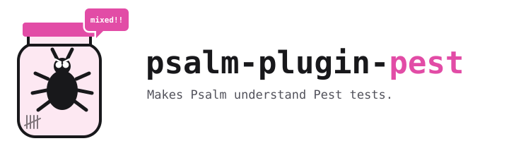

<p align="center">
  <picture>
    <source media="(prefers-color-scheme: dark)" srcset="art/lockup-dark.svg">
    
  </picture>
</p>

<p align="center">
  <strong>Your Pest tests, fully typed. Bugs contained.</strong>
</p>

<p align="center">
  <a href="https://packagist.org/packages/alies-dev/psalm-plugin-pest"></a>
  <a href="https://packagist.org/packages/alies-dev/psalm-plugin-pest"></a>
  <a href="LICENSE"></a>
</p>

Pest closures look like magic to [Psalm](https://psalm.dev). It thinks `$this` is a `TestCall`, so every `$this->anything` quietly resolves to `TestCall` again. Typos pass, types are wrong, and the bugs in your tests stay invisible.

This plugin teaches Psalm how [Pest](https://pestphp.com) really works. Keep your tests in the analysis, get real types and catch broken tests before you run them.

## Install

```bash
composer require --dev alies-dev/psalm-plugin-pest
vendor/bin/psalm-plugin enable alies-dev/psalm-plugin-pest
```

That's it. Make sure `tests/` is in `<projectFiles>` of your `psalm.xml`.

Requires PHP 8.3+, Psalm 6.19+ or 7, Pest 4 or 5.

## Before and after

```php
uses(Tests\TestCase::class);

beforeEach(function () {
    $this->cart = new Cart();
});

it('totals the cart', function () {
    $this->actingAs(admin());       // before: TestCall::__call(), unchecked
                                    // after:  Tests\TestCase::actingAs()

    $total = $this->cart->total();  // before: TestCall, so $total is TestCall
                                    // after:  Cart from beforeEach(), int

    expect($total)->toBeString();   // after:  PestImpossibleExpectation,
});                                 //         total() returns int
```

## Types it understands

| Pest code | Psalm sees |
|---|---|
| `$this` in tests, hooks and datasets | Your TestCase from `uses()` / `pest()->extend()`, plus its traits |
| `$this->user` set in `beforeEach()`, also as `$this->user['key'] = ...`, `[] = ...` or `??=` | A declared property with its type, also from `tests/Pest.php` |
| A function from `tests/Pest.php`, `Helpers.php` or `Helpers/` | Declared in every file under `tests/`, with its return type |
| `test()` with no arguments | The bound TestCase |
| `it('x')->actingAsAdmin()` | A resolved higher order call |
| `it('x')->expect(fn () => $this->cart)` | `$this` is your TestCase in higher order `expect()` / `and()` closures |
| `expect($user)->name->toBe('Ada')` | `Expectation<T>` through `->not`, `->each` and member access |
| `expect($user)->not->toBeNull()` | `$user` narrowed to non-null afterwards |
| `pest()->printer()`, arch chains | Public API, no `InternalMethod` noise |

## Bugs it catches

Each one is a test that is broken or will never run. Pest finds out at runtime, the plugin finds out in your editor.

| Issue | Example |
|---|---|
| `PestImpossibleExpectation` | `expect(42)->toBeString()` can never pass |
| `PestDuplicateTestDescription` | Two tests named `'works'` in the same file or `describe()` |
| `PestHookInDescribe` | `beforeAll()` / `afterAll()` inside `describe()` |
| `PestStaticTestClosure` | `test('x', static fn () => ...)`, where Pest cannot bind `$this` |

Suppress any of them like a regular Psalm issue.

## Known limitations

* `tests/Pest.php` is looked up next to your Psalm config. A test file outside `tests/` keeps Pest's own types.
* Files are parsed, never executed. A boot file with dynamic `uses()` calls disables TestCase resolution for the suite.
* Config only chains (`pest()->tia()`, `printer()`, `presets()`, `project()`, `browser()`, `evals()`) are ignored wherever they sit, including inside a loop.
* Custom expectations from `expect()->extend()` are still reported.
* Narrowing works on plain variables, not on `$this->prop`.
* Pest runs a higher order `expect()` / `and()` closure without the TestCase's class scope, so a protected or private TestCase member used there fails at runtime but is not reported.
* On Psalm 6, a closure passed to a higher order `it('x')->expect()` keeps `InvalidScope`, because Psalm 6 does not ask plugins about the arguments of a magic `__call()` method. A later `->and()` closure is bound.

Found a false positive? [Open an issue](https://github.com/alies-dev/psalm-plugin-pest/issues) with a snippet.

## License

MIT, see [LICENSE](LICENSE).
